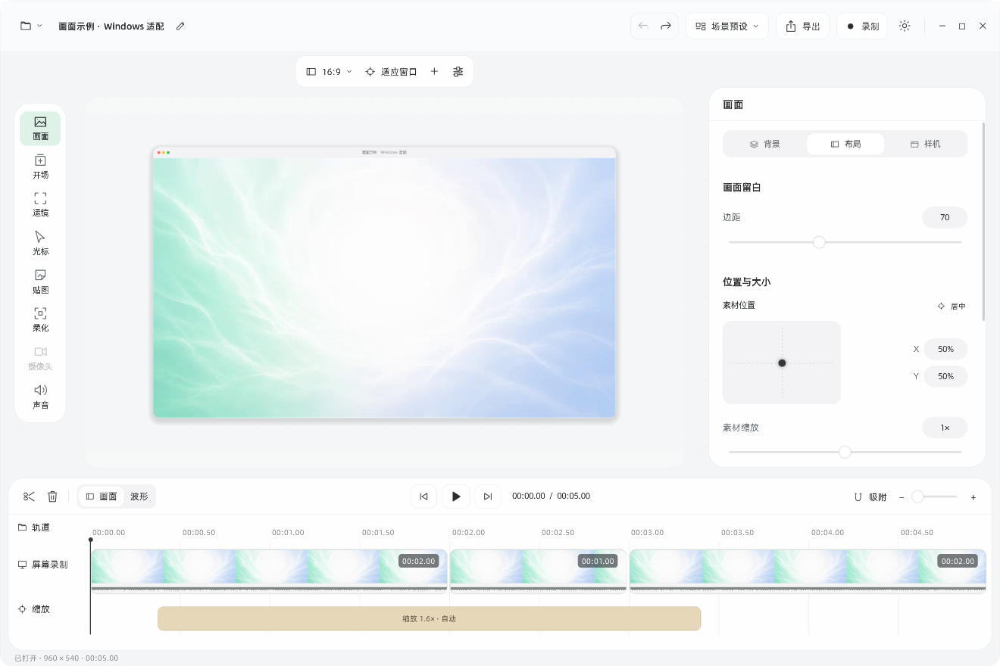
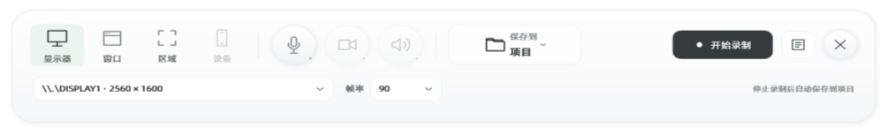
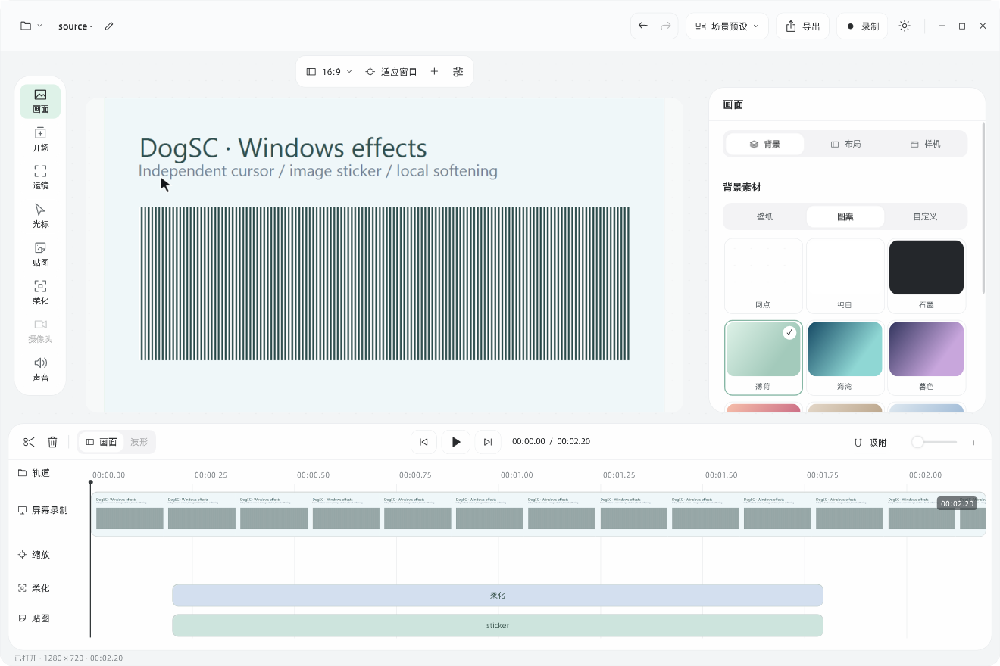
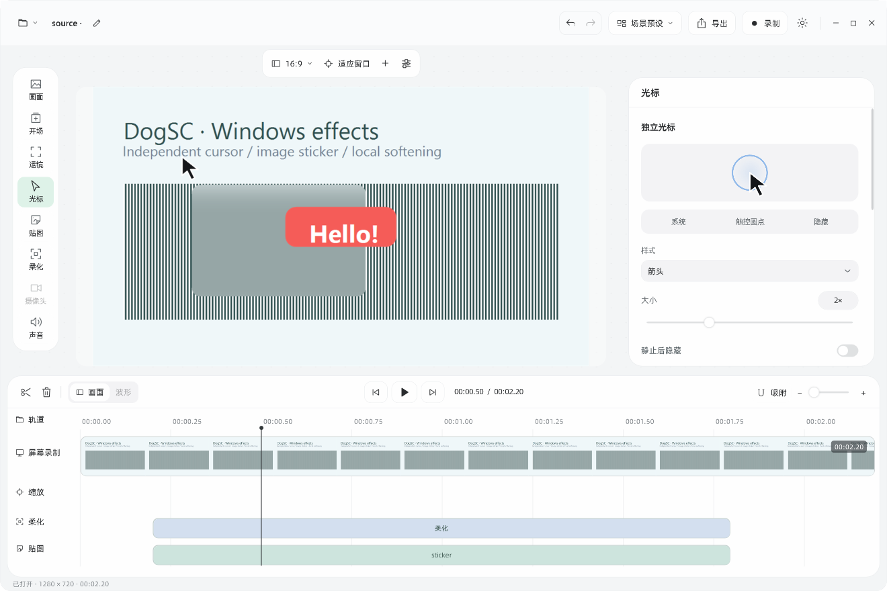
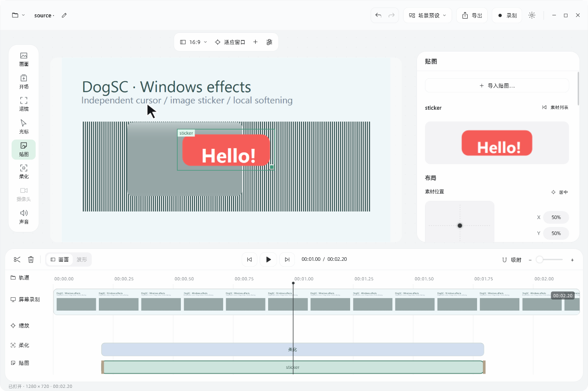
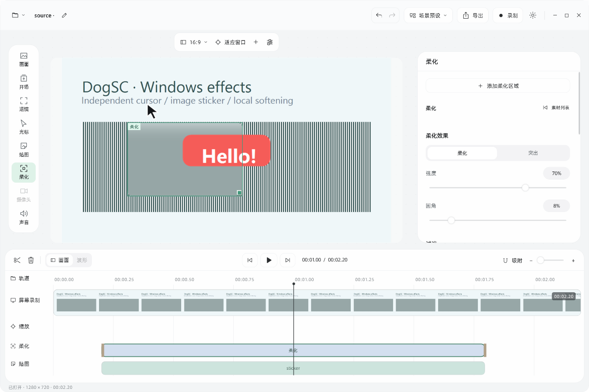
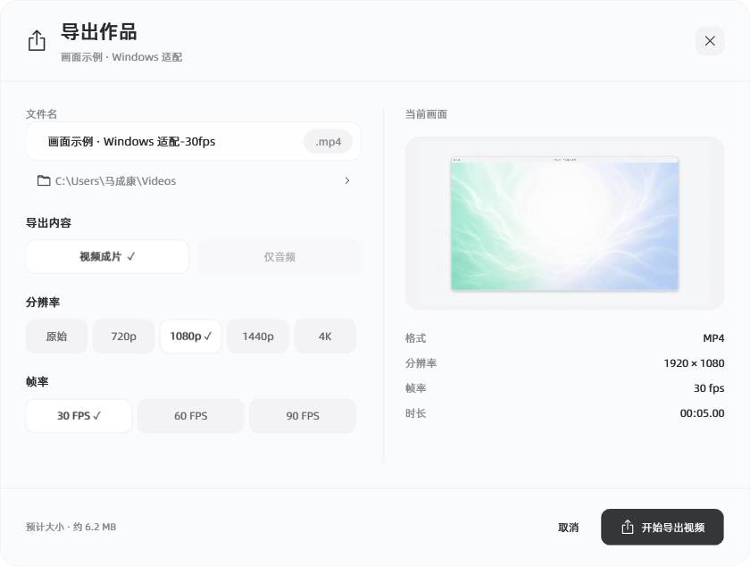

> **这是根据 [laogou717/dogsc（作者：神烦老狗）](https://github.com/laogou717/dogsc) 二次创作的非官方 Windows 版本。当前还不完善，尚未完整复刻 macOS 原版，欢迎体验与反馈。**
>
> 原作和本项目源码均采用 MIT，保留原作者版权声明。本项目不代表原作者的官方 Windows 发行版。

# DOGsc for Windows

面向 Windows 的录屏与轻量编辑工具：录制屏幕、整理时间线，让鼠标跟随、自动缩放和背景设计一起参与成片。

**[下载 Windows 体验版](https://github.com/adrian147258/DOGsc-for-Windows/releases/tag/v0.1.0-windows-beta.1)** · [全部 Releases](https://github.com/adrian147258/DOGsc-for-Windows/releases) · [反馈问题](https://github.com/adrian147258/DOGsc-for-Windows/issues) · [DogSC 原作](https://github.com/laogou717/dogsc)



## 下载与启动

1. 打开 [Release 下载页](https://github.com/adrian147258/DOGsc-for-Windows/releases/tag/v0.1.0-windows-beta.1)，下载名称带 **`win-x64.zip`** 的体验包。
2. **完整解压**到一个可写文件夹，例如桌面。不要直接在压缩包里运行。
3. 双击 `Windows/bin/DogSC.Windows.exe`；也可双击 `Start-DogSC.cmd`。
4. 保留整个文件夹结构。EXE 依赖随附的 XAML、字体和录屏工具，不能单独拿出来使用。

**运行环境：Windows 10/11 64 位、.NET Framework 4.8。** 下载包已包含 FFmpeg/ffprobe 与字体，无需额外安装录屏组件。当前没有安装器或代码签名。GitHub 自动附带的 **Source code** 是源码，不是可直接运行的体验包。

校验值在同一 Release 的 `SHA256SUMS.txt`。PowerShell 可用 `Get-FileHash .\下载的文件.zip -Algorithm SHA256` 核对。

## 当前可用的功能

| 部分 | 已实现 |
| --- | --- |
| 录制 | 显示器、窗口、区域选择；3 秒倒计时；30 / 60 / 90 FPS；DirectShow 麦克风选择 |
| 保存 | 停止后自动保留原始视频与 Windows 项目，分段 MP4、保存校验与错误诊断 |
| 时间线 | 分割、裁短、删除、重排、变速、撤销 / 重做，缩略图与基础音频波形 |
| 运镜 | 自动缩放、鼠标跟随、手动缩放片段、开场动效 |
| 画面 | 比例、留白、位置、大小、圆角、描边、阴影、窗口外框；壁纸、渐变和自定义图片 |
| 光标 | 独立形态、大小、点击反馈、平滑、静止隐藏、时间校准与摆动 |
| 贴图 | 透明 PNG / JPG、移动、缩放、旋转、透明度、层级、阴影和出入场动画 |
| 柔化 | 局部模糊与突出效果，位置、尺寸、强度、出现时间和过渡，随录屏运镜移动 |
| 备忘录 | 悬浮编辑 / 阅读、字体、透明度与自动保存，支持系统捕获排除 |
| 导出 | MP4；原始尺寸、720p、1080p、1440p、4K；30 / 60 / 90 FPS；取消导出 |

录制优先尝试 Windows 图形捕获与 NVIDIA NVENC，自动处理跨显卡和兼容回退；不可用时使用 CPU 编码。**目标帧率不等于每台电脑都能满帧**，屏幕刷新率、编码负载与复杂效果会影响实际流畅度。麦克风采集已接入，但尚未在多种实际设备上完整测试。

### 录制浮条



选择录制来源与帧率，点击开始；停止后会保存素材并进入编辑器。备忘录从浮条或项目菜单打开，文稿独立于视频项目保存。

### 背景、独立光标与贴图



背景支持本机壁纸、随附柔光素材、图案与自定义图片，场景预设使用图卡预览。布局参数使用数字胶囊与位置面板，预览和导出共用合成逻辑。



新录制的鼠标轨迹单独保存，编辑时可调整光标与点击反馈。**旧录屏或导入视频中已成为画面像素的鼠标，无法无损隐藏或替换。**



图片嵌入 `.dogscwin`，支持叠放与出入场动画。选框可直接拖动，右下角控制点调整大小；时间线控制出现范围。



柔化区域绑定录屏内容，随缩放移动；突出模式压暗选区之外的画面。两者均支持时间范围和过渡。

### 导出成片



原始视频只保留录屏内容。要得到带背景、光标、贴图和运镜的成品，请在编辑器点击“导出”。分辨率选项表示支持的输出规格，并不表示所有设备都已通过高负载 4K 稳定性验证。

## 素材与项目保存在哪里

- **录制素材与初始项目**：程序所在目录的 `Windows/recordings/日期时间-随机编号/`。`source.mp4` 是原始视频，`project.dogscwin` 是编辑项目。
- **编辑改动**：使用 `Ctrl+S` 保存。停止录制已保存原素材，不需要额外点保存才能保留它。
- **导出视频**：以导出窗口显示的目标文件夹为准。
- **备忘录与帧率偏好**：当前用户的 `%LOCALAPPDATA%/DogSC.Windows/`。

Windows 项目仍引用原始视频及自定义背景图片，移动项目时要同时保留这些文件；贴图图片已嵌入项目。Windows `.dogscwin` 与原作 `.dogscproject` 不兼容。

录制使用分段 MP4，异常中断后通常仍可读取已经完整提交的片段，尚未提交的尾段可能丢失。保存失败时保留素材与诊断文件，不把未完成文件当作成功保存。

## 当前不完善的部分

- **尚未移植**：摄像头叠加、系统声音采集、屏幕 3D、录制暂停与标记、效果复制粘贴、单独音频导出。
- **仍有差异**：界面、光标手形、运动引擎、模糊与阴影的 Windows 实现和 macOS 原版仍有细节差异；相邻贴图复杂衔接和摄像头联动尚未完成。
- **适配仍需验证**：小屏幕与高 DPI、HDR、受保护窗口、混合显卡、休眠恢复、长时间录制与高负载 4K。复杂效果可能增加 CPU 消耗。
- **兼容边界**：没有 AMD AMF / Intel QSV 自动选择；实际麦克风与不同显示驱动仍需更多设备验证；项目格式独立。

这是可体验的开发测试版，不能等同于原作功能完整度。已实测 30 / 60 / 90 FPS 合成窗口录制、保存、重开及 720p 导出；强制中断后的素材解码；时间线与光标 / 贴图 / 柔化交互、项目保存和成片导出；打包版启动。测试使用合成画面，不包含个人桌面或录制内容。

## 从源码构建

需要 Windows x64 与 .NET Framework 4.8。WPF 和 C# 编译器使用系统 .NET Framework；无需安装 Node.js 或 Xcode。

```powershell
git clone https://github.com/adrian147258/DOGsc-for-Windows.git
cd DOGsc-for-Windows

# 下载并校验第三方录屏组件
powershell -NoProfile -ExecutionPolicy Bypass -File .\Windows\setup-tools.ps1

# 编译 Windows 程序
powershell -NoProfile -ExecutionPolicy Bypass -File .\Windows\build.ps1

# 运行
.\Windows\bin\DogSC.Windows.exe

# 生成可分享 ZIP，仅复制运行依赖，不复制录屏与个人设置
powershell -NoProfile -ExecutionPolicy Bypass -File .\Windows\package.ps1
```

FFmpeg 二进制、生成的 EXE、录屏、测试输出与发行 ZIP 不提交进源码仓库。完整程序从 Release 下载；Windows 实现及构建脚本全部开源。

| 路径 | 内容 |
| --- | --- |
| `Windows/` | Windows C# / WPF 实现、界面与构建脚本 |
| `Sources/` | 保留的原作 macOS Swift 源码，供实现对照 |
| `Resources/` | 原版字体、图标与必要资源，保留各自来源与许可 |
| `docs/windows/` | 本 Windows 版本实际界面截图 |
| `README.upstream.md` | 保留的原作 README；其 macOS 功能描述不代表 Windows 已实现 |

更详细的实现差异与回归命令见 [Windows 开发说明](Windows/README.md)。

## 反馈与参与

欢迎提交 Issue 或 Pull Request。反馈请注明 Windows 版本、显卡、录制模式、分辨率、帧率与复现步骤。录制目录中的 `capture-backend.txt`、`capture-stop.txt`、`capture-performance.txt`、`capture-save-error.txt` 可辅助定位问题；启动异常见 `Windows/bin/last-error.txt`。提交前去掉个人路径和敏感内容，不必上传完整个人录屏。

## 致谢与许可

感谢 **神烦老狗** 开源 [DogSC](https://github.com/laogou717/dogsc)。Windows 版本参考原作源码、截图、参数与交互进行二次实现；原作版权声明完整保留。

**原作及 Windows 改编源码使用 [MIT License](LICENSE)。** 随附 FFmpeg / ffprobe 为 Gyan 的 GPL v3 构建，字体遵循自身许可，它们不会因本项目使用 MIT 而改变许可。

第三方版权、FFmpeg 构建配置、同版本主项目源码快照与外部库来源见 [THIRD_PARTY_NOTICES.md](THIRD_PARTY_NOTICES.md)。Release 下载区同时提供 FFmpeg 主项目源码快照和校验值。
